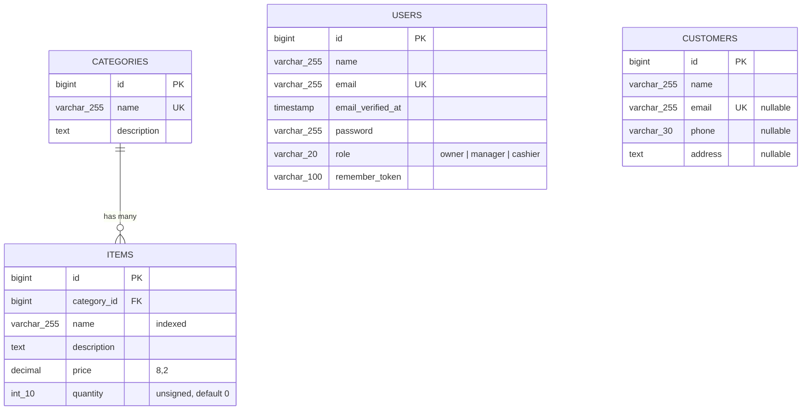

# Entity-Relationship Diagram

**Notes**
- One category has many items; each item belongs to exactly one category. The foreign key `items.category_id` uses `RESTRICT` on delete.
- `users` and `customers` are standalone tables. Users authenticate against the API; customers are shop records.
